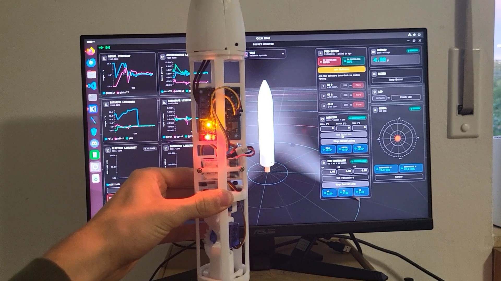

# Wisp Mk1



Wisp Mk1 is an extremely lightweight thrust-vector-controlled (TVC) model
rocket. The project combines a compact flight computer, a radio link, and a
desktop monitoring application to provide onboard control, telemetry, flight
logging, and ground-station operation.

This repository contains the **Alacer-1 flight computer firmware**. It runs on
an STM32F411-based controller and coordinates the rocket's sensors and
actuators during flight. The firmware includes:

- IMU and barometric altitude measurement
- Rotation and ascent tracking
- PD-based thrust-vector control
- Flight-state sequencing, including launch, burn, descent, and recovery
- Gimbal, motor ignition, parachute, pyro, buzzer, LED, battery, and radio
  hardware interfaces
- Telemetry, event logging, flash storage, and log download
- A simulation mode with mock hardware and a simple rocket model
- A request/response radio protocol used by the Rocket-Link system

## Wisp project

Wisp is split into several cooperating hardware and software components:

| Component | Description |
| --- | --- |
| [Mechanical design](https://cad.onshape.com/documents/95bcdae310df42bf9c944b22/w/453d5222de5aa817fef552d9/e/846b29e1962f732657283316) | CAD model of the Wisp Mk1 airframe and mechanisms |
| [Flight Computer](https://github.com/tomatencode/Alacer-1) | Hardware design for the Alacer-1 flight computer |
| [Flight Computer Firmware](https://github.com/tomatencode/Alacer-1-Firmwear) | Embedded firmware in this repository |
| [Rocket-Link](https://github.com/tomatencode/RocketLink-1) | Hardware design for the Rocket-Link ground/radio device |
| [Rocket-Link Firmware](https://github.com/tomatencode/RocketLinkFirmwear) | Firmware for the Rocket-Link device |
| [Rocket Monitor App](https://github.com/tomatencode/RocketMonitor) | Ground-station application for monitoring and operating the rocket |

## How the components communicate

The Wisp system is divided into an onboard side and a ground side:

```text
┌──────────────────────┐   USB    ┌──────────────────────┐  HC-12 radio  ┌────────────────────────┐
│ Rocket Monitor App   │◄────────►│ Rocket-Link          │◄─────────────►│ Alacer-1 Flight        │
│ Ground station       │          │ USB/radio bridge     │               │ Computer + firmware    │
└──────────────────────┘          └──────────────────────┘               └────────────────────────┘
                                                                            │
                                                           Sensors, gimbal, │
                                                           ignition, pyro,  │
                                                           and recovery     │
                                                                            ▼
                                                                      Wisp Mk1 rocket hardware
```

### Component responsibilities

- **Mechanical design** defines the airframe, payload mounting, gimbal
  mechanism, recovery system, and the physical interfaces between the rocket
  and its electronics. It does not communicate digitally, but it determines
  where the sensors and actuators can be installed and how they behave in
  flight.
- **Alacer-1 hardware** is the onboard flight computer. It connects the
  sensors and safety-critical actuators to the STM32 controller.
- **Flight computer firmware** runs onboard the rocket. It reads the IMU and
  barometer, estimates motion and altitude, controls the TVC gimbal, manages
  the flight sequence, records telemetry and events, and operates the ignition
  and recovery interfaces. The rocket can therefore continue a flight safely
  without depending on a continuous ground-station connection.
- **Rocket-Link hardware and firmware** form a small ground-side radio bridge.
  The device exposes a USB serial connection to the computer and uses an HC-12
  radio to transmit and receive bytes over the air. It forwards radio data
  without implementing the flight computer's commands, keeping the bridge
  simple and focused on transport.
- **Rocket Monitor** is the ground-station application. It sends commands,
  displays live telemetry and status, configures the flight computer, and
  downloads or monitors flight logs. It also provides the operator interface
  for the Rocket-Link USB connection.

### Protocol layers

Communication uses two separate framed protocols:

1. **Rocket Monitor ↔ Rocket-Link:** a USB packet protocol with packet types
   for pinging the bridge, sending radio data, receiving radio data, and
   issuing HC-12 configuration commands. Packets include a length and checksum
   so USB stream data can be recovered reliably.
2. **Rocket Monitor/Rocket-Link ↔ flight computer:** a radio-link protocol
   carried as the payload of the bridge packets. It supports multiple
   request/response messages per frame, sequence IDs, status values, CRC
   checking, and retries. Requests cover sensors, gimbal control, flight
   state, PD control, pyro and recovery controls, telemetry, and log
   management.

Telemetry and responses travel back along the same path in reverse:
the flight computer creates a response or telemetry message, Rocket-Link
bridges the radio bytes to USB, and Rocket Monitor decodes and presents them
to the operator.

### Why the project is split this way

The split keeps the time-critical and safety-sensitive work on the rocket,
where it can continue operating even if the radio link is interrupted. The
Rocket-Link device isolates radio and USB timing from the flight computer,
while Rocket Monitor can provide a richer user interface without consuming
onboard processor resources. Separating hardware, embedded firmware, radio
transport, and ground software also makes each part easier to test, replace,
and develop independently.

## Building

The firmware is built with [PlatformIO](https://platformio.org/) and the
Arduino framework:

```bash
pio run -e custom_f411ce
```

The default hardware target is a generic STM32F411CE board and uploads use
ST-Link:

```bash
pio run -e custom_f411ce -t upload
```

To build the on-device simulation configuration:

```bash
pio run -e custom_f411ce_sim
```

Additional host-side test runners and simulation documentation are available
in [`tests/`](tests/).

## Status and safety

Wisp Mk1 is an experimental hobby model-rocket project. The firmware and
hardware were developed by an amateur and should not be relied on without
careful, independent verification before use.