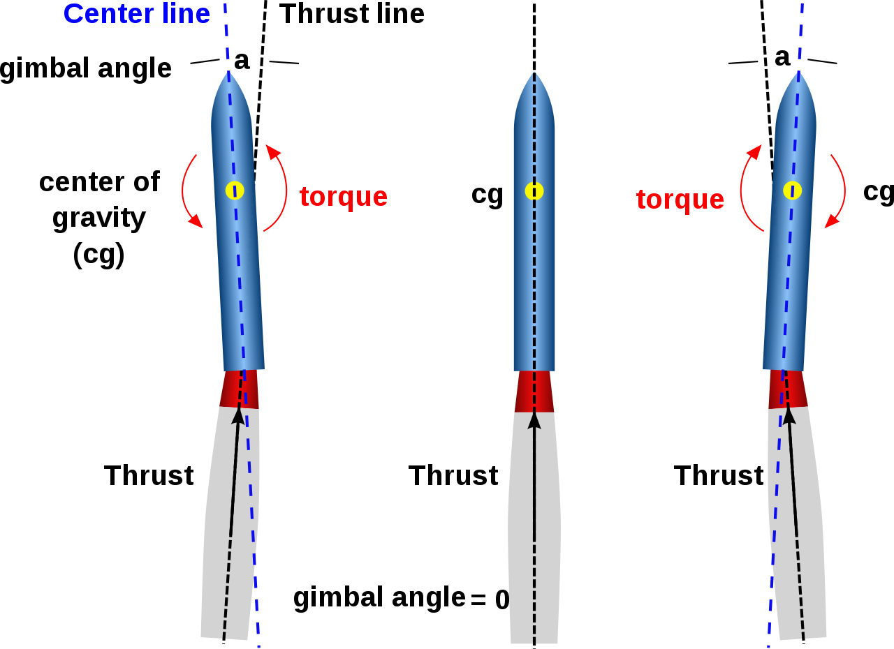
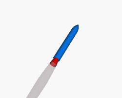
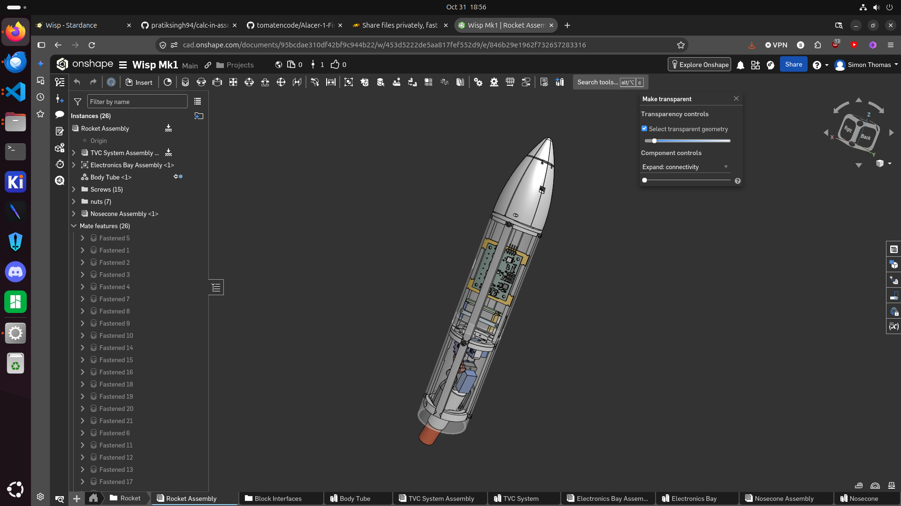
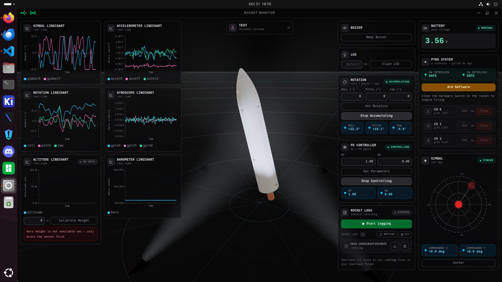
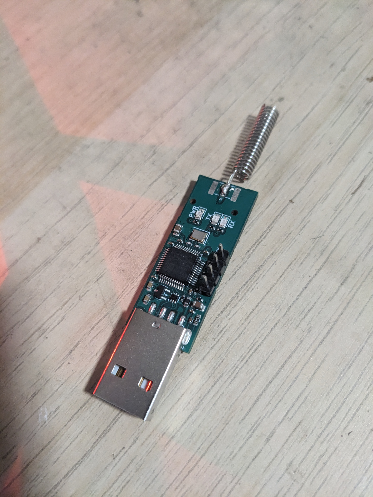
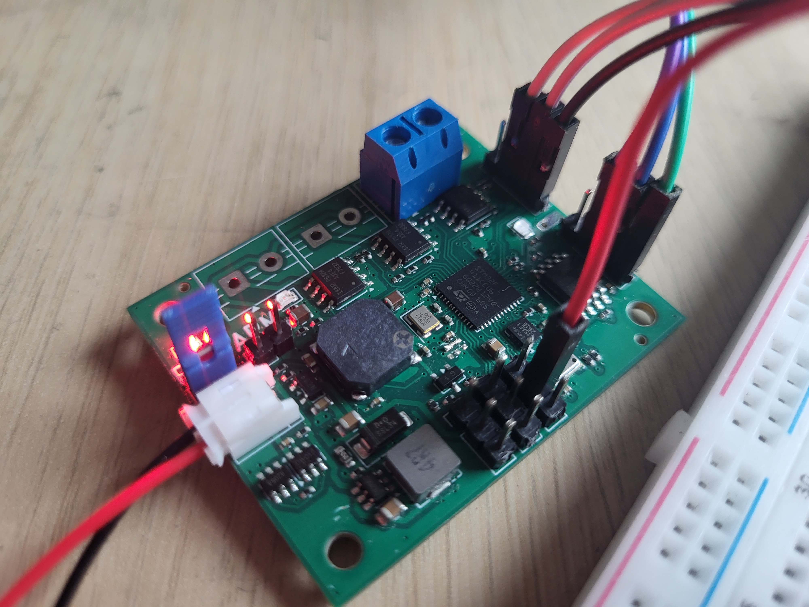

# Wisp Mk1


Wisp Mk1 is a lightweight model rocket that uses thrust vector control (TVC).
Its system includes a custom flight computer, a USB-to-radio bridge, and a
desktop monitoring app. Together, they control the rocket and provide
telemetry and flight logs.

## Flight stabilization

During powered flight, the firmware keeps the rocket near its target direction
by angeling the rocket motor:





The firmware uses gyroscope readings to estimate the rocket's attitude. A PD
controller compares this estimate with the target and uses the rotation rate
to adjust yaw and pitch. It measures roll but does not control it because the
rocket is axisymmetric. The gimbal redirects thrust to reduce unwanted
rotation and move the rocket back toward its target.

## Wisp project

Wisp is split into several cooperating hardware and software components:

| Component | Description |
| --- | --- |
| [Mechanical design](https://cad.onshape.com/documents/95bcdae310df42bf9c944b22/w/453d5222de5aa817fef552d9/e/846b29e1962f732657283316) | CAD model of the Wisp Mk1 airframe and mechanisms |
| [Flight Computer](https://github.com/tomatencode/Alacer-1) | Hardware design for the Alacer-1 flight computer |
| [Flight Computer Firmware](https://github.com/tomatencode/Alacer-1-Firmwear) | Embedded firmware in this repository |
| [Rocket-Link](https://github.com/tomatencode/RocketLink-1) | Hardware design for the Rocket-Link ground/radio device |
| [Rocket-Link Firmware](https://github.com/tomatencode/RocketLinkFirmwear) | Firmware for the Rocket-Link device |
| [Rocket Monitor App](https://github.com/tomatencode/RocketMonitor) | Ground-station application for monitoring and operating the rocket |

<table>
  <tr>
    <td align="center">
      <strong>Mechanical design</strong><br>
      
    </td>
    <td align="center">
      <strong>Rocket Monitor</strong><br>
      
    </td>
  </tr>
  <tr>
    <td align="center">
      <strong>Rocket-Link</strong><br>
      
    </td>
    <td align="center">
      <strong>Alacer-1 flight computer</strong><br>
      
    </td>
  </tr>
</table>

Splitting the project into separate parts makes them easier to develop
independently. This was the first design decision I made for the project.

The rocket was designed in Onshape and 3D printed. Both PCBs were designed in KiCad, then manufactured and assembled by PCBWay.

## How the components communicate

The Rocket Monitor app communicates with the flight computer through
Rocket-Link. Rocket-Link connects to the computer by USB and communicates to the rocket over Radio:

```text
+----------------------+   USB    +----------------------+  HC-12 radio  +----------------------+
| Rocket Monitor       |<-------->| Rocket-Link          |<------------->| Alacer-1 Flight      |
| Ground station app   |          | USB/radio bridge     |               | Computer + firmware  |
+----------------------+          +----------------------+               +----------------------+
```

## What the rocket can do

### Fly and stabilize itself

During flight, the firmware reads the IMU and barometer to track the rocket's
movement and altitude. It follows the flight sequence from launch to recovery
and uses the TVC gimbal to keep the rocket pointed in the right direction.
It can continue this work even if the radio connection is lost.

### Run a simulated flight

The simulation mode replaces the flight sensors, gimbal, igniter, parachute,
and clock with simulated versions. This makes it possible to test the flight
sequence and control code on the flight computer without using real flight
hardware. Radio, logging, battery measurement, LEDs, and the buzzer still use
the real hardware.

### Record flight logs

The flight computer saves sensor data, altitude, velocity, gimbal position,
rotation, battery state, and flight events to its flash storage. These logs can
be downloaded after a flight to review what happened.

### Send live telemetry

Rocket Monitor can request the rocket's current data through Rocket-Link. This
includes live sensor readings, altitude, flight state, and other status
information. The same connection can send configuration changes and commands
to the flight computer.

## Building

The firmware is built with [PlatformIO](https://platformio.org/) and the
Arduino framework:

```bash
pio run -e custom_f411ce
```

The default target is a generic STM32F411CE board. Uploads use ST-Link:

```bash
pio run -e custom_f411ce -t upload
```

To build the on-device simulation configuration:

```bash
pio run -e custom_f411ce_sim
```

See [`tests/`](tests/) for host-side test runners and simulation documentation.

## Safety

Wisp Mk1 is a hobby model rocket project. An amateur developed its firmware
and hardware. Check them carefully before use.